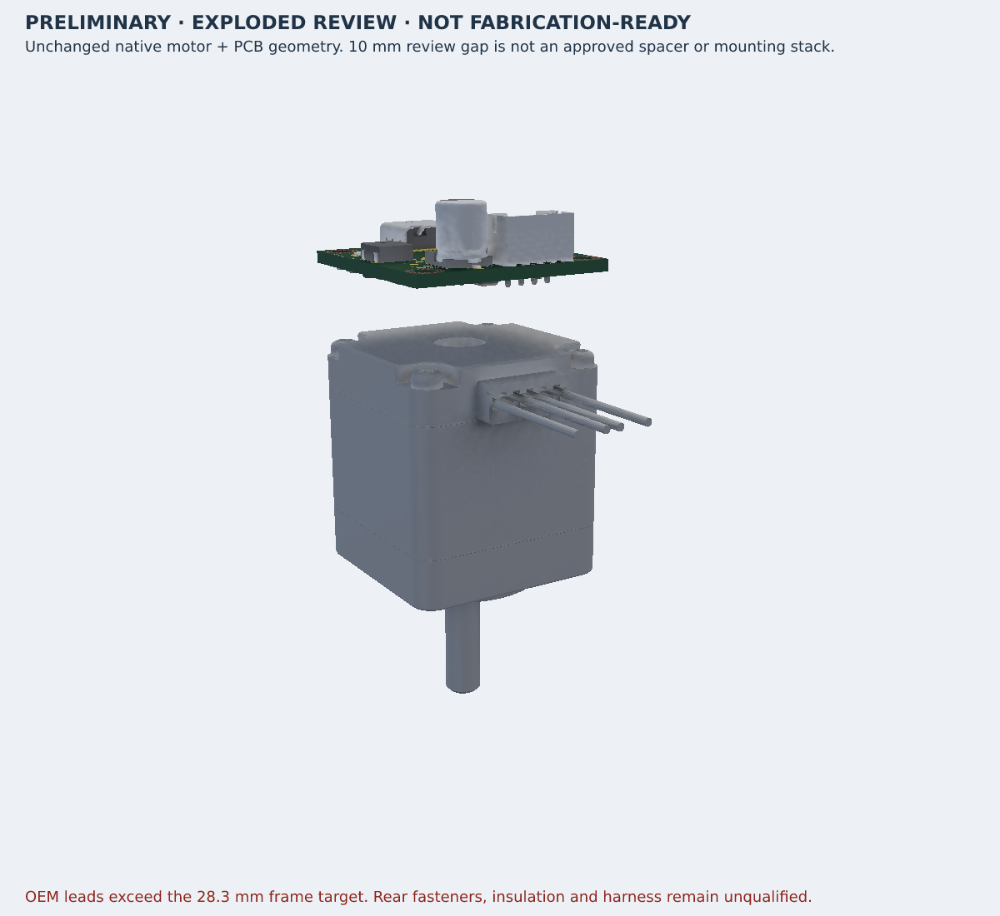

# Motor assembly checkpoint, 2026-11-10

Version `0.6.8-motor-assembly-wip`. Electrical source, placement, connectivity
and supplier component definitions are unchanged from `b62ede0`. The user
requested opposite-side USB ports and a motor assembly. **Only the motor
assembly preview is implemented in this checkpoint.** All recorded opposite-edge
USB candidates are rejected, and active USB placements remain adjacent.

## Native evidence

- Main Circuit JSON SHA-256: `44a681858961bb94c2c150e7acef6d8d2a1dab3bc70e3a7f244a58175aae9bf7`.
- Assembly Circuit JSON SHA-256: `3e356b4919839505d09f5acba519f7e3f4e19d5f1508620696f8cd0d0d864660`.
- Electrical source SHA-256: `e534b89873edec43ccdd36525f7566f7a63e1ff36d9e1778b2a6ebedb37199ce`.
- Both before/after complete-input receipts are equal and outputs fresh.
- Both native builds exit 1 with the two retained USB boundary errors.
- 48 prebuild tests, eight root tests, nine opposite-edge audit tests, 10 emitted
  contracts and 657 source/import assertions pass. Source regeneration, type
  and formatting checks pass. Independent nominal geometry passes unchanged.
- Native netlist: zero errors/warnings. Pin check: 30 warnings. Schematic: four
  findings. Source check: five datasheet-service warnings, four timeouts and
  one HTTP 500. Strict source, pin and schematic gates fail. No warning is waived.
- Placement analyzer still reports three optional-encoder courtyard findings
  and nine orientation suggestions. Routing remains disabled, with zero traces/vias.

## Actual assembly audit

The emitted motor uses genuine package-local OEM STEP/OBJ, zero rotation and
translation (0, 0, -42.3) mm, with unit scale and explicit zero model origin.
Its quantity-one assembly BOM is verified. All **4,078** electrical, schematic,
PCB and existing CAD records match the main board exactly. Diagnostic and
project metadata differences are reported separately, not silently normalized.

All 89 fitted PCB CAD models were evaluated in their original coordinates
using native origins/rotations/positions. Missing models: 0. Minimum nominal
component-to-motor Z separation is **8.170000 mm** in the explicitly
exploded view. This does not specify a real required gap or approve a mounting
stack. The PCB-bottom-to-motor-rear separation is 10 mm for visualization only.

The unchanged complete motor spans 28.2 × 48.2 mm because of its four supplied
straight lead stubs. The main solid's wire exit still spans 31.2 mm in Y even
without leads. Thus the 28.3 × 28.3 mm whole-frame requirement fails. Rear bolt
thread, length, engagement, torque, insulation, thermal clearance, PCB support,
plug/overmold/tool access and harness routing remain unqualified. No fasteners,
spacers, carrier or replacement geometry are invented.

## Visual review and publication

The default native 480 × 320 thumbnail frames the PCB and crops the motor.
The full image above uses the same unmodified native GLB with an explicit
whole-scene camera. Both original output hashes and the derivative camera/hash
receipt are retained. The image is a WIP review, not an assembly approval.

GitHub and the existing tscircuit package are the intended destinations,
including both native Circuit JSON files. Publication status is recorded
separately; no successful hosted preview is assumed. Previous release 0.6.7
timed out after 30 minutes despite byte-verified runtime files. Its last
server log only reported “Starting execution”; no root cause is established.
