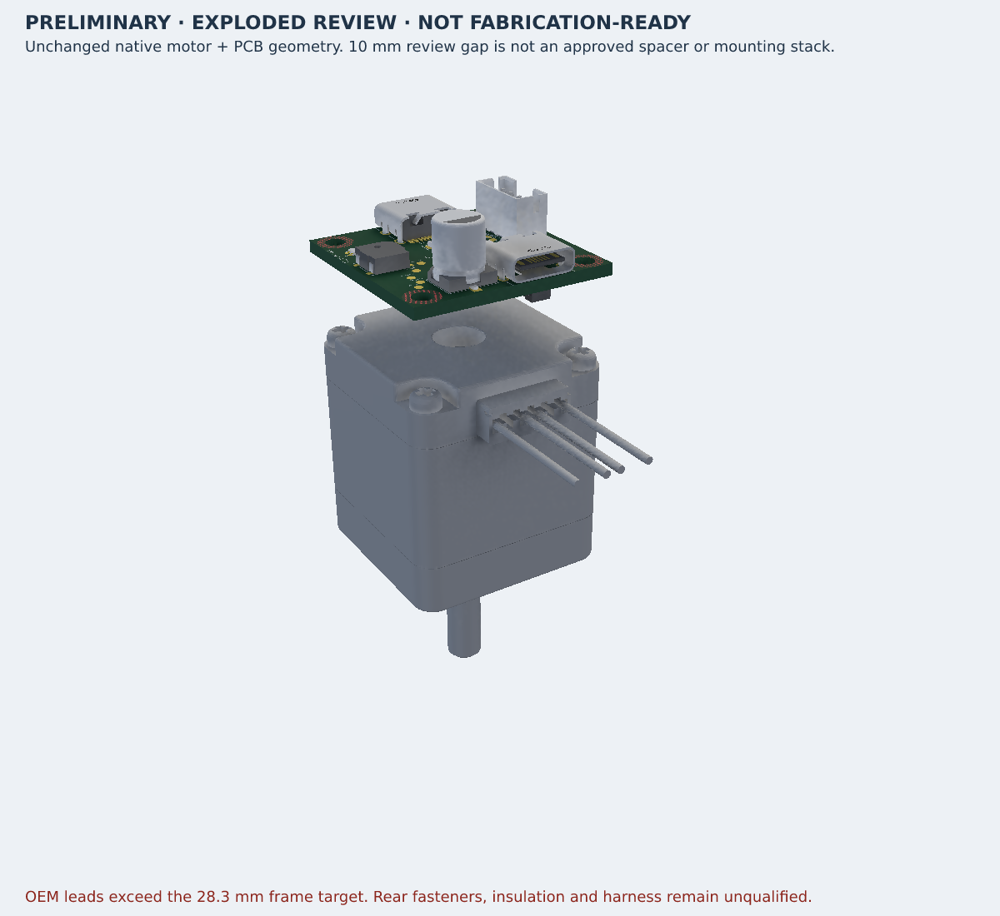

# Opposite-side USB floorplan, 2026-11-10

Version `0.6.9-opposite-usb-wip` continues motor checkpoint `0be7261`.
Power USB J_PD remains north at (0, 8.65) mm, rotation 180°. Data USB J_DATA
is south at (3.8, -8.65) mm, rotation 0°. The ports occupy opposite edges;
they are not claimed to be centered on one axis or upright connectors.
The source remains a two-sided, unrouted WIP with unchanged supplier definitions
and netlist. No manufacturing release follows from this update.

## Placement and real geometry

There are 45 coordinated component moves, recorded completely in
`references/opposite-usb-20261110/placement-review.json`. The data USB, its ESD
and input network move together; the motor header moves to the east while
retaining genuine vertical/top-entry mating. The driver and bypass parts move
north, with neighboring support circuitry re-laid out on both layers.

The new audit checks actual native component poses against the reviewed full
placement, all copper including DNP copper, fitted courtyards, plated shell
tabs, genuine USB locator holes, motor mounting holes, board edges and
provisional screw-head envelopes. Own-connector NPTH-to-copper must be at
least 0.15 mm; other-component NPTH-to-copper must be at least 0.25 mm.
The stronger latter value is an explicit project screening margin. Missing,
duplicate, moved, malformed or nonfinite locator geometry fails closed.
The old audit and rejected search evidence remain historical and unchanged.

This expanded check found real existing PD locator/copper overlaps that the
older pad-only screen missed. Exact old circle-to-rectangle gaps were
-0.133660 mm against R_PD_CFG and -0.225289 mm against U_PD. These parts
are physically repositioned, not exempted. The DATA/R_CC1 old copper gap was
positive (0.239923 mm); distinguish its courtyard/extra-margin issue from
literal copper overlap. Existing upstream checks PR #311 covers the missing
component-owned-hole check; no duplicate fix or dependency patch is included.

## Electrical placement review

All physical pin/net assignments are unchanged. C_BULK is physically rotated
180° at its same new XY so pin1 (PD_VBUS) faces north; pin2 remains GND.
No pin identity, footprint, symbol or supplier model is overridden. Compared
with the immediately preceding unrotated candidate, nearest-pad conservative
PD_VBUS separation to the driver improves 12.055→7.468 mm, while GND grows
5.271→8.851 mm. The longer ground return explicitly needs routing review.
Against the historical board, those values were 9.931 mm and 3.775 mm.
Positive separation to the local VM ceramic improves 8.269→2.962 mm versus
the unrotated candidate. Neither origin nor edge distances are routed lengths,
loop area, impedance, current capacity or thermal qualification.

DATA-to-ESD and ESD-to-bypass origin separations remain 1.15 mm and 2.45 mm.
PD bypass geometry improves; driver CP1/CP2 and VREG pad distances improve,
while some logic/VM bypass distances increase modestly. Complete same-net
pad, origin and polarity comparisons remain in the adjacent pinned review
JSON files. Actual routing, ground continuity, Kelvin paths, differential USB
impedance, power loops, thermal behavior and bench tests remain open.

## Access and assembly limits

The unchanged imported USB mesh registration places nominal outer faces at
Y≈±14.000029 mm, approximately flush with the board edge. The 0.250021 mm
courtyard overhangs remain visible and unapproved; nothing is shrunk, recessed
or exempted to suppress the native findings. Actual plug/overmold and panel
arrangements remain unqualified. The east JST header is top-entry; the raw
model includes pins about 1.4 mm below the PCB bottom. Cable/hand/extraction
access and solder/insulation/fastener tolerances still require physical review.

The genuine motor remains in an explicitly exploded 10 mm review separation,
not an approved spacer or mounting stack. Its full lead and wire-exit geometry
still fails the saved whole-frame target. No geometry is cropped or invented.

## Test-pad accessibility correction

The first native opposite-side trial (JSON SHA-256
`11d68f0dcf975618857600955ad9aa564c7c25f97412d5123aa413c222dd7a3f`)
reported TP_BOOT_GND inside the moved U_DRV courtyard. Checking whole pads,
rather than only their centers, additionally found partial TP_BOOT and TP_3V3
courtyard overlaps. The three pads were physically moved with unchanged nets:
TP_BOOT and TP_BOOT_GND to X=6.2 mm at their existing Y coordinates, and TP_3V3
to (-9.35,-7.2) mm. The source error and relevant native geometry remain in
`references/opposite-usb-20261110/testpoint-access-review.json`.

The new gate measures the actual seven circular copper pads against the fitted
courtyard polygons. All clear nominally, with minimum pad-edge gap 0.199981 mm.
This is not a probe/fixture envelope or access qualification; no probe size was
invented. Offline verification passes 70 prebuild and eight repository tests,
generated-source reproducibility, TypeScript and formatting.

## Small nominal margins still need qualification

The fitted C_BUZZER / R_DM courtyard gap is only 0.0009999 mm, and R_PWR_LED
courtyard / J_MOTOR plated-tab gap is only 0.0099996 mm. Minimum provisional
R2.35 motor screw-head envelope separation is about 0.075 mm. These are positive
nominal model distances, not tolerance budgets or assembly clearance approval.
The limiting records are explicitly identified in the audit; no body, pad or
motor geometry was reduced to make this candidate pass.

## Final native outputs and visual review

- Main Circuit JSON SHA-256: `d07d9965d138ab20566007170f2b5ecf6586a6cec1393fdfe3dfe928a01abdf0`.
- Assembly Circuit JSON SHA-256: `bae418ea862b7cfa21ef5b9d29fa185d824bacd7021dd87b79afefb7fe67713a`.
- Native assembly GLB SHA-256: `c19cf8bb6811194e195f06528da7d6bc0b4505d91a801afff2218aa84dc74fa7`.
- Both complete-input receipts cover 291 unchanged files. Both builds exit 1
  for the two retained USB boundary errors. Freshness does not imply gate success.
- Eleven emitted contracts, 657 source/import assertions and expanded geometry
  pass. All 99 source components, 346 ports, 67 nets and 310 source-trace records
  match published `0be7261` exactly. All 4,078 electrical/schematic/PCB/existing
  CAD records match between normal and motor assembly outputs.
- Netlist and separate final source check are clean. Main JSON retains 19
  datasheet-service timeout warnings from its build; assembly JSON has none.
  Pin check retains 30 warnings and schematic check retains four findings.
  Placement analyzer retains three optional-encoder courtyard findings and eight
  orientation suggestions. The real top-entry motor header lacks supplier
  insertion-direction metadata; its native horizontal-inference warning remains.
- Seven schematic A4 pages and native top/bottom PCB views were regenerated.
  Full assembly pixels were inspected: complete motor, shaft, original lead stubs,
  PCB and both opposite USB bodies are visible. Actual mating and access are not
  qualified by this image. The normal native thumbnail remains cropped.

The full view changes only the camera of the unmodified native GLB. Its derivative
receipt retains source/output hashes and whole-scene bounds. No motor, board,
connector or fastener geometry was fabricated for the image. Publication to the
existing GitHub repository and tscircuit package is tracked separately.
