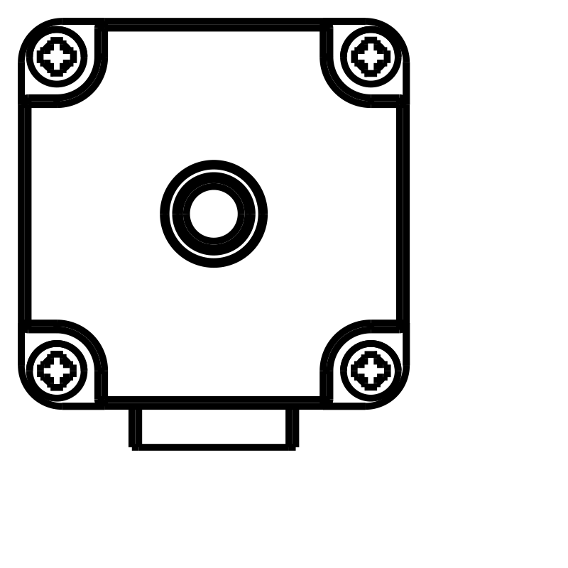

# Direct mounting using the motor bolts

The active requirement is **four PCB mounting locations on the motor's existing
rear case-bolt axes, with no custom carrier, case clamp or enclosure**. This
supersedes the 25 mm pitch / M1.6 carrier proposal. That proposal and the
published 0.4.x assemblies are historical references, not the requested mount.

The current controller PCB/source has now been changed in place: four **Ø2.7 mm
holes on a 23 mm square**, with centres at X/Y = ±11.5 mm and all-six-layer head
exclusions of radius 2.35 mm. The drill is a **provisional design clearance for a
shank up to 2.5 mm**, not a claim that the rear bolts are M2.5. The design reserves
a maximum 4.5 mm head plus 0.10 mm radial allowance. See
[`compact-motor-bolts.json`](../config/compact-motor-bolts.json). Native alignment
now passes; component placement and copper routing must be corrected and all
manufacturing checks rerun for the changed board.

[Current A4 PCB bolt-pattern drawing](../artifacts/requirements/direct-motor-bolts/current-PCB-motor-bolts-A4.pdf)
shows the actual four revised holes, coordinate origin, PCB/frame edges and head
exclusions. Its [verification](../artifacts/requirements/direct-motor-bolts/current-drawing-verification.json)
binds the drawing to the current native PCB hash. It is a mechanical review,
not an approved drilling or fabrication release.

The unchanged original STEPPERONLINE STEP contains **four existing rear bolt
heads on a nominal 23 × 23 mm square**, at X/Y = ±11.5 mm. Their convex cylindrical
head surfaces have nominal Ø4 mm and Z = 29–30 mm in the OEM coordinates. These
are actual model features, not newly invented rear holes. No rear shaft is
assumed. The nominal rear body maximum is Z = 31.5 mm.



The [CAD inspection](../artifacts/requirements/direct-motor-bolts/nominal-step-bolt-audit.json)
checks the original model hash, the four head axes and their convex surface
normals. It now compares those axes against the current changed PCB and confirms
alignment. The former 25 mm holes were **1.414 mm from each corresponding motor
bolt axis**; that old geometry and its zero-error copper reports are historical.

The published drawing specifies **front M2.5 mounting threads**, at 23 ±0.15 mm
pitch and 3.5 mm minimum thread depth. It does **not** specify the rear case-bolt
thread, under-head length, engagement or torque. Equal nominal front/rear pitch
does not establish that the bolts have the same thread. The CAD's visible head
diameter does not establish a shank diameter, thread or maximum head tolerance.

The [direct mounting contract](../config/direct-motor-bolt-mounting.json) leaves
rear bolt specifications unverified. Provisional PCB drill/head design limits
are set explicitly and must be checked against the actual hardware. An added PCB and any standard insulating spacers
consume bolt length. Original bolts must retain proper motor clamping and
engagement; correctly specified longer bolts may be needed. The recessed heads,
metal rear cover, PCB bottom copper, case temperature and mechanical support
also need an actual insulation/spacing design. There is no approved direct
assembly or orderable hardware selection yet.

Default controller preview now shows the **current hole-revised PCB and genuine
OEM motor together**, with the four bolt axes aligned. The native assembly has
77 models and no carrier. The nominal rear-body gap is 2 mm for this clearance
study; clamp hardware and final insulation/support are not represented as
qualified. The unchanged OEM solid retains its seated original bolt heads, not
invented longer screws. Its original wire stubs are preserved and extend beyond
the frame toward the JST edge; final terminated harness fit remains unresolved.

[Current native GLB](../artifacts/compact-six-layer/development-assembly.glb)
and [geometry/export verification](../artifacts/compact-six-layer/current-assembly-geometry.json)
check every fitted supplier STEP pose and the OEM motor against the actual
native GLB. This proves export geometry, not collision-free attachment or valid
routing. Historical motor/carrier rebuilding requires `--historical-carrier`.

Future controller publications update versions of the existing
[`AnasSarkiz/NEMA11_RP2040_Compact_Prototype`](https://tscircuit.com/AnasSarkiz/NEMA11_RP2040_Compact_Prototype)
package. Earlier separately named studies remain historical; no additional
package name is needed for this revision.

Reproduce the geometry inspection with the CAD environment:

```sh
/workspace/.venvs/nema11-cad/bin/python scripts/inspect_direct_motor_bolts.py
# This now checks the actual revised current PCB's 23 mm hole alignment.
/workspace/.venvs/nema11-cad/bin/python scripts/inspect_direct_motor_bolts.py --require-compatible-pcb
/workspace/.venvs/nema11-cad/bin/python scripts/verify_direct_motor_assembly.py
```

The PCB requires placement and routing changes around its updated holes, then
fresh DRC, every-pin connectivity, shorts, CAM, BOM/CPL and complete native 3D
assembly checks. The old zero-error electrical results do not qualify a new
layout. This mounting redesign is **not fabrication-ready**.
