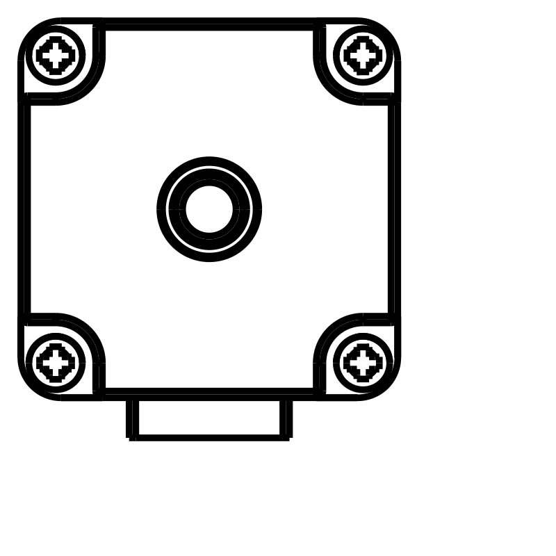

# Direct mounting using the motor bolts

The active design is the [two-layer board](../boards/nema11-rp2040-two-layer--20261022-a1/).
It must use four PCB mounting locations on the motor's existing rear case-bolt
axes, with no custom carrier, case clamp or enclosure. Its
[current requirements](../boards/nema11-rp2040-two-layer--20261022-a1/config/requirements.json)
define the provisional PCB hole and head clearance dimensions. These remain
unqualified until actual rear hardware and assembly tolerances are confirmed.

## What the unchanged motor evidence establishes

The original STEPPERONLINE 11HS12-0674S STEP contains four existing rear bolt
heads on a nominal **23 × 23 mm square**, at X/Y = ±11.5 mm. Their convex
cylindrical head surfaces are nominally Ø4 mm at Z = 29–30 mm in OEM coordinates.
The nominal rear body maximum is Z = 31.5 mm. These are actual model features,
not invented rear holes; no rear shaft is assumed.



The [retained CAD inspection](../artifacts/requirements/direct-motor-bolts/nominal-step-bolt-audit.json)
records the original model hash, head axes and convex surface normals. Its PCB
comparison is historical and names the deleted six-layer board. It does not
prove alignment or qualification of the active two-layer source.

The manufacturer drawing specifies **front M2.5 mounting threads**, at
23 ±0.15 mm pitch and at least 3.5 mm thread depth. It does not specify the rear
case-bolt thread, under-head length, engagement or torque. Matching nominal
front/rear pitch does not establish matching threads. A CAD head diameter does
not establish the shank size, thread or maximum tolerance.

## Qualification still needed

The [direct-mounting contract](../config/direct-motor-bolt-mounting.json) keeps
rear bolt specifications unverified. An added PCB and insulating spacers consume
bolt length. Original bolts must preserve proper case clamping and engagement;
correctly specified longer bolts may be needed. Rear-cover metal, bottom copper,
case temperature, screw/tool access, insulation and PCB support need an actual
assembly design and physical verification.

The retained [A4 bolt-pattern drawing](../artifacts/requirements/direct-motor-bolts/current-PCB-motor-bolts-A4.pdf)
and [drawing verification](../artifacts/requirements/direct-motor-bolts/current-drawing-verification.json)
are frozen evidence for the removed six-layer snapshot. The word `current` in
those historical filenames is not a current status claim. Likewise, the earlier
25 mm carrier drawings do not define the current requirement. See the
[removal and recovery record](legacy-six-layer-removal.md).

The shared OEM inspection tool remains available for an explicitly selected
native PCB, with fresh results written separately:

```sh
python3 scripts/inspect_direct_motor_bolts.py \
  --input /path/to/approved-native-board.circuit.json \
  --out /path/to/new-mechanical-review \
  --require-compatible-pcb
```

This needs the documented CAD dependencies and existing native board output.
It performs a nominal geometry comparison only. It does not run a native build
or qualify clamping hardware, component placement, copper or manufacturing.
